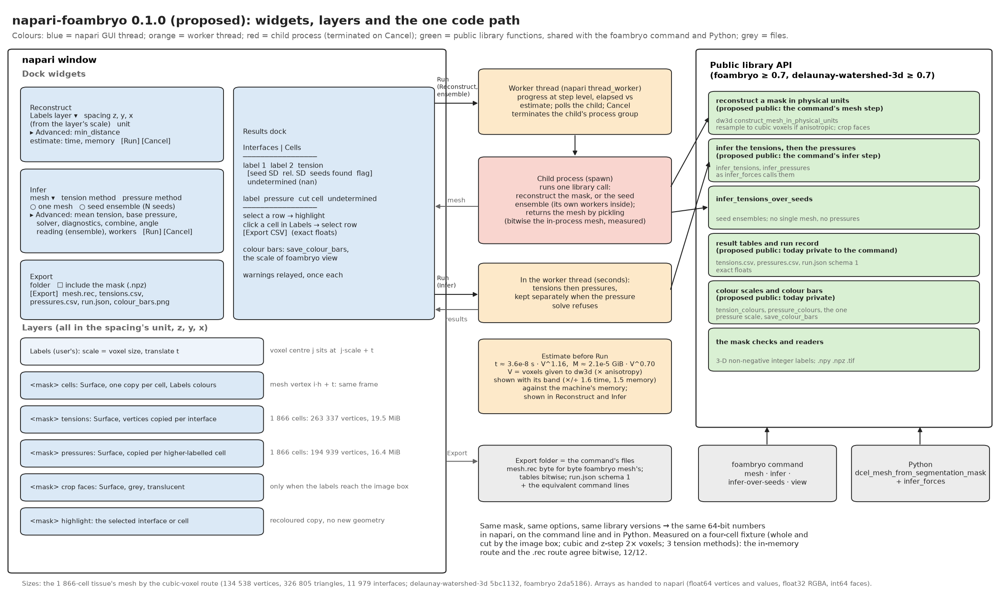
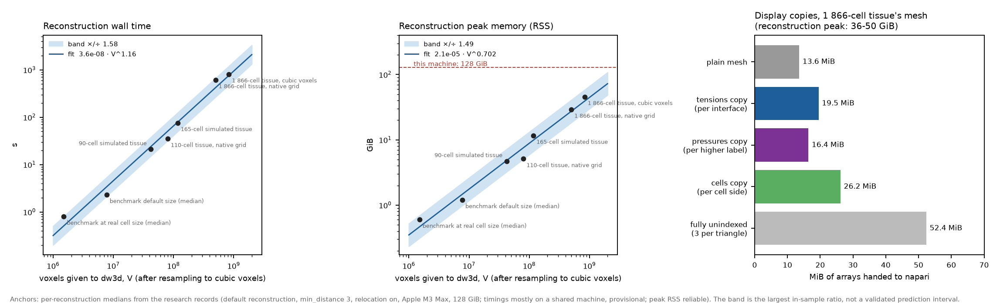

# napari-foambryo — specification, version 1 (approved)

A napari plugin that turns a 3-D segmentation into a multimaterial mesh with delaunay-watershed-3d, infers its
relative surface tensions and cell pressures with foambryo, shows them on the tissue, and exports the same files
as the `foambryo` command.

Version 0 was the draft of 11 October 2026. The maintainer approved it the same night, answered its eleven open
questions (now the decisions of § 11) and added one requirement: going from a segmentation made by another napari
plugin to foambryo without leaving napari (§ 1.7, with changes to §§ 2.1, 2.3, 6.2, 8 and 9). Where this text
and the implementation disagree, the text is the intent and the code is a defect.

*Figure 1. The proposed plugin: dock widgets and layers (blue, napari's GUI thread), the worker thread and the
child process that run long steps (orange, red), and the public library functions they call (green), which the
`foambryo` command and plain Python call too. Sizes are for the mesh of a 1 866-cell tissue reconstructed by the
cubic-voxel route (134 538 vertices, 326 805 triangles, 11 979 interfaces; delaunay-watershed-3d 5bc1132,
foambryo 2da5186).*

**Evidence labels.** `SOURCE-VERIFIED`: read in the current source of the libraries (foambryo's command branch at
669a976, delaunay-watershed-3d `master` at 68eccf4) or in napari's documentation. `MEASURED`: a run whose script
and output are in the plugin repository's research record. `INFERRED`: derived from measurements, not measured as
such. `TO VERIFY`: an open fact to check during the build.

**Words.** *The library*: delaunay-watershed-3d (`dw3d`) and foambryo, version 0.7 or later. Version 0.7 is not
released yet: both sources read 0.6.0 today, and the command and the seed ensembles are on a foambryo branch under
review, so the plugin is built against that branch (decision Q1). *The command*: the
`foambryo` executable (`mesh`, `infer`, `infer-over-seeds`, `view`) and its behavioural specification,
`docs/command_line_specification.md` in foambryo. *A mask*: a 3-D array of non-negative integer labels, 0 the
medium, axis 0 = z, axis 1 = y, axis 2 = x.

---

## 0. Principles

1. **One code path.** The plugin computes nothing scientific of its own. Every number it shows or writes is a
   number a public library function returns for the same inputs, the same functions the command calls. Same
   mask, same options, same library versions: bitwise the same 64-bit numbers in napari, on the command line and
   in Python (§ 6).
2. **No default of its own.** Every option's default is read from the library function's signature when the
   widget is built, as the command does. A library default that changes moves the plugin with it.
3. **Parity with the command.** The plugin offers the options the command offers, no more (§ 2.4). An option the
   command lacks is added to the library and the command first, so that a run in napari can always be reproduced
   on the command line.
4. **Nothing silent.** No default voxel size; every warning the library raises is shown once, with its count;
   undetermined values stay `nan` and are drawn as no value (§ 3.6); a crop boundary is never drawn or reported as contact with
   the medium.
5. **The libraries stay headless.** napari, Qt and magicgui are dependencies of the plugin only. Neither library
   gains a GUI dependency.

---

## 1. Users and tasks

The user is a biologist or a physicist with a 3-D instance segmentation of a tissue (from Cellpose, PlantSeg,
napari's own label tools, …) who wants relative tensions and pressures without writing code, and wants to see
where they come from. Six tasks, each a path through the widgets of § 2.

### 1.1 A segmentation to tensions and pressures on the tissue

1. Open the segmentation: drag a `.tif`, `.npy` or `.npz` into napari, or use *Open segmentation…* in the
   Reconstruct widget, which reads it with the command's own reader and adds a **Labels** layer (a TIFF that
   napari opens as an Image layer can be converted with napari's *Convert to Labels*).
2. Set the voxel size if the layer does not carry it (§ 2.1). The Reconstruct widget shows the estimated time
   and memory (§ 5.2).
3. *Reconstruct* → the mesh appears over the labels, one colour per cell (the Labels layer's colours).
4. *Infer* → interfaces coloured by tension, cells by pressure, the colour bars and the results table.
5. Select a row → the interface or cell is highlighted; click a cell in the Labels layer → its row is selected.

### 1.2 Anisotropic stacks

A stack whose z step is larger than the pixel size (napari layer `scale = (dz, dy, dx)` with `dz > dy = dx`).
The library resamples the mask to cubic voxels of the shortest spacing by shape-based interpolation before
meshing (`construct_mesh_in_physical_units`, `SOURCE-VERIFIED`), so the reconstruction handles `k = dz / dx`
times the voxels and `min_distance` counts cubic voxels. The widget says so before the run, with the cost (§ 5.2).
A spacing with two different short axes is refused with the library's message (`coarse_axis_and_factor`). Above
an anisotropy of 3, where the accuracy was not measured, the library's `UnmeasuredAnisotropyWarning` is shown;
the mesh is built anyway.

### 1.3 Cropped tissues

Where labels reach a face of the image box, the reconstruction marks the cell surfaces on that face as **crop
faces** and the cells as **cut cells** (every image face is a crop, as in the command). The plugin draws the crop
faces as their own see-through, edged layer (glass), flags cut cells in the table, and shows the pressures the library
returns for them: `nan`, with the library's `CutCellPressureWarning` (`SOURCE-VERIFIED`; the warning fires for
the 3 cut cells of a four-cell fixture cut by the image box, `MEASURED`). A pressure method that has no formulation for crop faces is refused by the
library (`MEASURED`: `weighted-laplace` raises `ValueError` on that fixture); the plugin shows the refusal and
keeps the tensions, as the command does (status `"pressures refused"` or `"failed"`).

### 1.4 Seed ensembles

The reconstruction places its points with a seeded dither; two seeds give two slightly different meshes and
tensions. *Infer → seed ensemble* calls `infer_tensions_over_seeds` (seeds 0 … N−1, N = 8 by default, fixed
before the run and never chosen on a result) and shows the ensemble tension, the seed standard deviation (a
lower bound on the error, not an error bar, as the library documents), the number of seeds that found each
interface and the flag for interfaces found by fewer than half of the seeds. No pressures: no single mesh carries
them. Display: see § 3.5 (decision Q4).

### 1.5 Large tissues

Before a run that is estimated to take more than a minute, the widget states the estimate as a range, for
example for a 1 866-cell tissue at cubic voxels (8.3 × 10⁸ voxels after resampling): *"about 13 min (8–20) and
39 GiB (26–59); this machine has 128 GiB"*. When the estimate exceeds the machine's memory, the Run button asks
for confirmation (§ 5.3). Inference itself takes seconds with the default solver (`solver="auto"`: sparse above
2 000 unknowns), so the estimate concerns the reconstruction and the ensembles.

### 1.6 Export and reproducibility

*Export* writes, in a folder, the command's own files: the mesh as `foambryo mesh` writes it (byte for byte), the
tables and the run record as `foambryo infer` writes them (bitwise the same numbers), the colour bars, and
optionally the mask with its voxel size. The run record names the command lines that reproduce every number
(§ 2.3). A user can therefore send the folder to a colleague without napari, or re-run the large case on a
bigger machine with the command and open the result back in napari with the `.rec` reader.

### 1.7 From another plugin's segmentation to foambryo, in one viewer

A user segments a membrane stack with another napari plugin (Cellpose, PlantSeg, micro-sam, napari's own label
tools, …) and goes on to foambryo without leaving napari or saving a file.

1. **Any Labels layer is an input**, whoever made it. A context-menu entry on Labels layers, *Reconstruct with
   foambryo*, selects that layer in the Reconstruct widget and shows the widget (npe2's layer context menu,
   `TO VERIFY` in the supported napari versions; without it, the widget's layer list does the same).
2. **Spacing when the labels do not carry it.** Segmentation plugins do not always copy the image's scale to the
   Labels layer they create. *Spacing from*: this layer, another layer (typically the image that was segmented),
   or typed. Never guessed; the choice is written in `run.json` (§ 2.3).
3. **What other tools produce** is accepted as it is: any integer type; labels need not be consecutive (a label is
   a name, and it is kept); a leading axis of length 1 (time or channel) is dropped, with a message; a multiscale
   layer is read at its full-resolution level; a dask or zarr array is read into memory (the estimate counts it).
   Refused, with the reason: 2-D data, several time points, floating-point or boolean data, negative labels.
4. **The medium label.** foambryo's medium is label 0; some tools give the background another label. *Medium is
   label …* (default 0): another choice creates a new, visible Labels layer `<mask> (medium = 0)` with that label
   and 0 swapped, and that layer is what is reconstructed. Export then always includes the mask, because the
   equivalent command needs it. The plugin changes the mask in no other way.
5. **A mask report before Run**, computed by the library (`segmentation_mask_report`, § 6.2) so that `foambryo
   mesh` prints the same summary: the number of cells; the cells touching the image box (they will be cut cells);
   the cells in several pieces; the pieces of medium enclosed by the tissue; the very small labels. A report only:
   nothing is changed. Whether such fragments should be cleaned is a question for the library; a cleaning option
   would come from it later.
6. **Results that are out of date.** When the source Labels layer changes (the user paints, or the segmentation
   plugin runs again), the mesh and result layers are marked *out of date (the labels changed)* and Export is
   disabled until Reconstruct runs again. Detected from the layer's events and, at Export, from the SHA-256 of
   its data against the one recorded at Run (the events alone could miss a change made in place).
7. **Provenance.** `run.json`'s `source_mask` records the layer's origin as napari keeps it (`Layer.source`: the
   file path, the reader plugin, or the widget that made it; `TO VERIFY` in the supported versions), so that a
   result names the segmentation step it came from.

---

## 2. Widgets and their options

Three dock widgets (*Reconstruct*, *Infer*, *Export*), a results dock (§ 4), a *View* dock (explode and cut,
§ 3.6b), a reader, a writer and sample data (§ 7). Advanced options sit in a folded section, closed by default. Every default below is the library's,
read from the signature at start-up; the value in brackets is today's.

### 2.1 Reconstruct

| option | default | where it comes from |
|---|---|---|
| Labels layer | the selected Labels layer, or the one the context menu named (§ 1.7) | the viewer |
| spacing from | *this layer* | *this layer*, *another layer* (a list of the viewer's layers), or *typed* (§ 1.7) |
| spacing (z, y, x) | the chosen layer's `scale` | napari; see below |
| spacing unit | the chosen layer's `units` if set, else `um` | napari (`TO VERIFY`: `Layer.units` exists in the supported napari versions), the command's fallback |
| medium is label | `0` | the library's medium; another value makes a swapped copy (§ 1.7) |
| `min_distance` (always shown) | dw3d's (`3`) | `get_default_mesh_reconstruction_algorithm` |

* **Spacing.** A layer's `scale` is the voxel size in napari's (z, y, x) order, the order of dw3d's points.
  There is no default spacing: when the chosen scale is napari's own default (1, 1, 1) and carries no unit, the
  widget shows *"voxel size unknown (napari's default scale): enter it, take it from the image layer, or confirm
  voxel units"* and Run stays disabled until the user confirms (decision Q3). *Another layer* must have the
  same 3-D shape as the labels (after a dropped leading axis), or the widget says why it cannot be used. The
  widget validates the spacing as typed with `dw3d.mask_preprocessing.coarse_axis_and_factor` and shows, for an
  anisotropic one, *"resampled to cubic voxels of {h} {unit}: {k}× the voxels; min_distance counts cubic
  voxels"*.
* **Mask checks**: 3-D, integer, non-negative, the command's checks (made public, § 6.2), after the
  accommodations of § 1.7 (a leading axis of length 1 dropped, the full-resolution level of a multiscale layer,
  a lazy array read into memory; the estimate counts it). A 4-D layer with several time points, a 2-D layer,
  floating-point or boolean data and negative labels are refused with the reason. A Labels layer with a
  rotation, shear or affine other than scale and translate is refused (`TO VERIFY` whether napari exposes them
  separately in every supported version).
* **Mask report** (§ 1.7): shown under the options as soon as a layer is chosen, computed in the worker thread
  for a large mask. It never blocks Run.
* **Run** reconstructs in a child process (§ 5.1) and adds the layers of § 3. **Cancel** terminates it; nothing
  is added. The summary line is the command's: *"134 538 points, 326 805 triangles, 1 942 cells (0 cut by the
  image boundary)"*.
* **Out of date** (§ 1.7): a change of the source layer's data marks the result layers and disables Export
  until the next Run.
* Left out of 0.1.0: the faces of the image box where the tissue really ends (`physical_image_faces`), the
  resampling method (`"nearest"`), the reconstruction seed. The command offers none of them (principle 3,
  decision Q2).

### 2.2 Infer

| option | default | where it comes from |
|---|---|---|
| mesh | the last reconstructed mesh, or one opened with the reader | the plugin's layers |
| mode | *one mesh* | — |
| tension method | `young-dupre` | `infer_forces(mode_tension=)` |
| pressure method | `variational` | `infer_forces(mode_pressure=)` |
| *pressures* | on | on: `infer_forces`' two calls; off: the tensions only, `infer_tensions` (`foambryo infer --no-pressures`) |
| *Advanced:* mean tension | `1` | `infer_forces(mean_tension=)` |
| *Advanced:* base pressure | `0` | `infer_forces(base_pressure=)` |
| *Advanced:* solver | `auto` | `infer_forces(solver=)` |
| *Advanced:* diagnostics | `none` | `infer_forces(diagnostics=)`, the command's three values |

In *seed ensemble* mode the options are those of `foambryo infer-over-seeds`:

| option | default | where it comes from |
|---|---|---|
| number of seeds N (seeds 0 … N−1) | `8` | `DEFAULT_ENSEMBLE_SEEDS` |
| tension method | `young-dupre` | `infer_tensions_over_seeds(mode=)` |
| *Advanced:* combine | `tensions` | `infer_tensions_over_seeds(combine=)`; `angles` is experimental and says so |
| *Advanced:* angle reading | `chord` | `infer_tensions_over_seeds(angle_reading=)` |
| *Advanced:* workers | `1` | `infer_tensions_over_seeds(max_workers=)`; the widget suggests a value from memory (§ 5.3) |
| `min_distance`, spacing | the Reconstruct widget's | shared, so the ensemble meshes the same mask the same way |

* Method names are the command's spellings (`option_name` of the library's enumerations): thirteen tension
  methods and three pressure methods today, listed from the enumerations, never from a copy.
* **Run (one mesh)**: the tensions, then the pressures, by the same two calls `infer_forces` makes, kept
  separately so that the tensions survive a pressure solve that refuses them (the command's behaviour). Runs in a
  child process, whatever the solver, so that the window never waits for it and Cancel stops it (§ 5.1; amended
  13 October 2026).
* **Run (seed ensemble)**: `infer_tensions_over_seeds` in a child process; its own workers inside.
* Left out of 0.1.0: the angle reading for a single mesh (`infer_forces` and `foambryo infer` do not take it;
  decision Q2), the wedge refusal, the uncertainty estimates (`infer_tensions_with_uncertainty`: a lower bound
  only, and not in the command), the sparse threshold.

### 2.3 Export

A folder chooser and one button. What is written:

| file | content | identical to |
|---|---|---|
| `mesh.rec` | the reconstructed mesh, with its metadata appendix (physical frame, spacing, unit, crop faces) | `foambryo mesh MASK -o mesh.rec --spacing …`, byte for byte |
| `tensions.csv`, `pressures.csv` | one row per interface / material, exact floats | `foambryo infer mesh.rec -o FOLDER`, byte for byte |
| `solves.csv` | with diagnostics `basic` or `spectrum`: one row per linear solve | the same, but for the solves' wall times |
| `spectra.npz` | with diagnostics `spectrum` | the same |
| `run.json` | schema 1 of the command's run record, plus keys (below) | the same keys and values, except `command`, `arguments`, `date`, `elapsed_seconds`, `versions` |
| `colour_bars.png` | `save_colour_bars` on the shown values | `foambryo view --colour-bars` |
| `mask.npz` (optional, off by default: decision Q5; always written when the medium label was swapped, § 1.7) | arrays `mask`, `spacing`, `spacing_unit` | what `foambryo mesh` reads |
| `seed-ensemble/tensions.csv`, `tensions_per_seed.csv`, `run.json` | when an ensemble was run | `foambryo infer-over-seeds`, byte for byte for the tables |

* Keys added to `run.json` (a schema may gain keys, never lose or rename one): `"source_mask"` (layer name,
  shape, dtype, SHA-256 of the array's C-order bytes, spacing, unit, `spacing_from` (*this layer*, the other
  layer's name, or *typed*), the medium label and whether it was swapped, the dropped leading axis if any, the
  multiscale level read, the layer's origin as napari records it, and the mask report), `"equivalent_commands"` (the command lines
  that reproduce the folder, for example `foambryo mesh mask.npz -o mesh.rec --min-distance 3` then
  `foambryo infer mesh.rec -o . --tension-method young-dupre --pressure-method variational`), and
  `"versions"` gains `napari` and `napari-foambryo`.
* Export is disabled while the results are out of date (§ 1.7), with the reason shown on the button.
* **A folder that already holds foambryo's outputs** (an earlier export, or the command's files, `seed-ensemble/`
  included): a dialog lists them and offers *Replace* or *Cancel*. Only those files are replaced (the command's
  `--overwrite` rule); any other file in the folder is never touched.
* Export writes the **last inference** (its options are in `run.json`). When the Infer dock's options differ from
  it (diagnostics chosen after Infer, for example), Export says which, and that Infer must run again.
* The *Export CSV* button of the results dock writes one table alone, in the same format.
* **Writer contribution**: a plugin Surface layer saved with napari's *File → Save Layer* as `.rec` writes the
  mesh file above. Other layers are declined.

### 2.4 What the first version leaves out, and why

| left out | why |
|---|---|
| `physical_image_faces`, resampling method, seed, single-mesh angle reading | not in the command (principle 3, decision Q2) |
| uncertainty / error bars | a lower bound only; not in the command |
| per-edge local tension fields, line tensions | research features; line tensions are in development |
| stress glyphs, force vectors, per-cell stress tensors | the Polyscope viewer (`foambryo view`) keeps them |
| meshes from other tools (`.vtk`, `.vtu`, …) | the command reads them, but a napari reader claiming `.vtk` would compete with other plugins; `.rec` / `.arec` only |
| editing the segmentation | napari's own label tools do it; the plugin reads the layer as it is at Run |

---

## 3. Layers

### 3.1 The constraint

napari's Surface layer colours **vertices**, not faces (`SOURCE-VERIFIED`, napari 0.9 API: `vertex_values`
with a colormap, or `vertex_colors` of shape (N, 3|4), or a texture; no per-face colour). A multimaterial mesh
shares every junction vertex between three or more interfaces, so a uniform colour per interface (tensions) or
per cell (pressures) needs a **display copy** in which each vertex is duplicated once per group it belongs to.
The library's mesh is never modified; each display copy keeps the index map back to the library's triangles.

### 3.2 The layers

All names start with the mask layer's name, so several tissues can be open at once.

| layer | type | geometry | colours |
|---|---|---|---|
| *(user's)* Labels | Labels | the mask | napari's |
| `<mask> cells` | Surface | copy per cell side (each cell a closed surface) | the Labels layer's colour of each cell, so the mesh matches the labels |
| `<mask> tensions` | Surface | copy per interface | `tension_colours` (`coolwarm`), centred on the mean tension; an undetermined interface not filled (alpha 0) |
| `<mask> tensions (undetermined: outlines)` | Surface | the undetermined interfaces of the tensions' copy | transparent faces, a wireframe in `UNDETERMINED_COLOR` (green) |
| `<mask> pressures` | Surface | copy per higher-labelled material of each triangle (as `foambryo view` draws its surface), or per cell side when exploded; crop faces left out | `pressure_colours` (reversed `magma`, trimmed to 10-90 %), the one pressure scale |
| `<mask> crop faces` | Surface | the crop faces only | glass: `CROP_FACE_COLOR` at `CROP_FACE_OPACITY` (in the vertex colours), a wireframe in `CROP_FACE_EDGE_COLOR` |
| `<mask> highlight` | — | none: the selected interface or cell is shown by recolouring its copy, the others desaturated | — |

* `vertex_colors` carry the library's own colours (`foambryo` colour functions, RGBA), so the colours handed to
  napari are bitwise those of the Polyscope viewer; napari's lighting then shades them as Polyscope's does. A
  *flat colours* toggle sets `shading="none"`, for reading a colour against the bar. `vertex_values` carry the
  value itself, so napari's status bar can show it under the cursor (`TO VERIFY` in 3-D).
* The *scattered* pressure view reuses the library's own `DcelData.compute_scattered_arrays` (each cell moved away
  from the tissue's centroid by a coefficient), as `foambryo view --scattered` would.
* Interfaces on crop faces are not in the tension layer (the library removes them from the equations); crop faces
  are only in their own layer.

### 3.6b Explode and cut (the *View* dock)

* **Explode**, a slider from 0 (off) to 1: each cell moves by the library's displacement,
  `DcelData.compute_scattered_arrays(coeff)` (`coeff × (cell centroid − tissue centroid)`, the coefficient of the
  Polyscope viewer's scattered view). The plugin reads the displacement once, at `coeff = 1`, and multiplies it by
  the coefficient, which is the library's own arithmetic: the exploded positions are bitwise the library's (gate).
  Exploded, each interface is drawn on both of its cells' sides in its tension's colour, each cell in its pressure's,
  the crop faces with their cut cell. The pressure scale stays the unexploded surface's, so the Results dock's bar
  holds for both. Layers are redrawn in place (visibility, opacity and blending stay the user's); a selected row
  stays selected.
* **Cut**: a plane normal to z, y or x, at a position in the mesh's unit (a slider across the run's box as drawn),
  keeping the lower or the higher side, on every layer of the run and on its Labels layer. It is napari's clipping
  planes (`experimental_clipping_planes`), which clip Surface and Labels layers in napari 0.9.2 (`MEASURED` in a
  real window); the plane is given in each layer's data frame, so that it is one plane in the world. Clipping
  planes act in the 3-D view only.
* Explode and cut combine; nothing is computed again.
* **Background** (added 13 October 2026, the maintainer's request: some cells vanished on the black canvas): napari's
  theme, black, dark grey, light grey, white (the library's `BACKGROUND_COLOURS`, the Polyscope window's choices) or
  a custom colour from a colour dialog, set as `viewer.canvas.background_color_override` (napari 0.9.2's public
  model, `MEASURED`: any RGB is accepted); the layers and their colours are not touched. `ViewWidget.set_background`
  does the same from Python.

### 3.3 Memory cost of the display copies

`MEASURED` (script `count_display_copy_sizes.py`, output `display_copy_sizes.json`), on the 1 866-cell tissue's
mesh reconstructed by the cubic-voxel route (134 538 vertices, 326 805 triangles, 11 979 interfaces, 1 942 labels):

| copy | vertices | triangles | arrays handed to napari |
|---|---:|---:|---:|
| plain mesh (for reference) | 134 538 | 326 805 | 13.6 MiB |
| tensions, per interface | 263 337 (1.96×) | 326 805 | 19.5 MiB |
| pressures, per higher-labelled material | 194 939 (1.45×) | 326 805 | 16.4 MiB |
| cells or scattered pressures, per cell side | 288 511 (2.14×) | 569 702 | 26.2 MiB |
| fully unindexed (3 vertices per triangle) | 980 415 | 326 805 | 52.4 MiB |

Arrays counted as float64 vertices and values, float32 RGBA colours, int64 faces. napari and its renderer keep at
least one further float32 copy on the GPU with normals (`INFERRED`, of the same order). All four layers together
are about 80 MiB, against a reconstruction peak of 36–50 GiB for the same tissue (§ 5.2): the display is not the
constraint. Building the copies is vectorised (one `np.unique` over (group, vertex) pairs).

*Figure 2. Left and centre: the measured reconstruction costs the pre-run estimate is fitted to (seven anchors,
from 1.5 × 10⁶ to 8.3 × 10⁸ voxels), the power-law fit and its band. Right: the display copies of § 3.3.*

### 3.4 Frames: the mesh over the Labels layer

* A Labels layer with `scale = s` and `translate = t` places the centre of voxel index `j` at world position
  `j · s + t` (napari's convention, voxel centres at integer indices).
* The library's mesh is in the unit of the spacing, with the centre of the mask's first voxel at the origin: a
  point at index `i` of the cubic grid is at `i · h`, `h = min(spacing)` (`construct_mesh_in_physical_units`,
  `SOURCE-VERIFIED`), which is `j · s` for the native index `j` of the same point.
* The Surface layers therefore get `scale = (1, 1, 1)` and the Labels layer's `translate`: the overlay is exact
  by construction, with no rescaling of the mesh. A test checks it (§ 8, gate G8).
* The layers record their provenance in `layer.metadata["foambryo"]` (kind, source layer, spacing, unit, run
  identifier), which the writer and Export read.

### 3.5 Seed ensembles on screen

The ensemble has no mesh of its own. The proposal: show the ensemble tensions on the mesh of the Reconstruct
widget (the library's default seed, 42, which is deliberately not in the ensemble's 0 … N−1), matched by label
pair; mesh interfaces the ensemble did not find are drawn as undetermined (green outlines, no fill); ensemble interfaces absent from that mesh appear only in
the table, marked *not on the displayed mesh*. The layer is named `<mask> ensemble tensions (N seeds, shown on
seed 42's mesh)` (decision Q4).

### 3.6 Colour maps and colour bars

The same scales as `foambryo view`, computed by the same functions:

* tensions: `coolwarm` (blue for low, light grey for the mean, red for high), over a range centred on the mean of the
  finite tensions and symmetric around it, to the farther of the 5 % and 95 % quantiles (`tension_colour_range`),
  clipped (amended 12 October 2026, the maintainer's choice; until then `jet` between the two quantiles);
* pressures: reversed `magma` trimmed to its 10-90 % range (amended 13 October 2026, the maintainer's choice: the
  whole map's black end vanished on napari's black canvas), from 0 to the 95 % quantile of the finite pressures over
  the surface's triangles (`surface_pressure_colour_upper`), the one pressure scale of the viewer's surface, graph
  view and bars;
* `nan` (undetermined): a tension's interface is not filled and its own layer draws it as a green wireframe
  (`UNDETERMINED_COLOR`, #1b9e77, outside both maps on napari's black background); a cell's pressure is filled green;
* crop faces: see-through glass with its edges drawn, never a value's colour (left out of the pressure layers).

The results dock shows the bars drawn by `save_colour_bars` itself (an image), so that a bar and its colours
cannot disagree. napari's own colour-bar overlay is not used: it is drawn from a layer colormap, which a layer
coloured by `vertex_colors` does not have.

---

## 4. Results table

A dock with two tabs.

**Interfaces** (one row per interface):

| column | one mesh | seed ensemble |
|---|---|---|
| label 1, label 2 | ✓ | ✓ |
| tension | ✓ | ensemble tension |
| seed SD, relative seed SD | — | ✓ (`tension_seed_sd`, `relative_tension_seed_sd`) |
| seeds found | — | ✓ (`n_seeds_found` of N) |
| found by fewer than half of the seeds | — | ✓ flag |
| undetermined | ✓ (`nan`) | ✓ |
| on the displayed mesh | — | ✓ (§ 3.5) |

**Cells** (one row per material, medium 0 included, as `pressures.csv`): label, pressure, cut by the image box
(from the mesh's `cut_cells`), undetermined. With the tensions only, the tab says that no pressure was computed.

**Diagnostics**: with diagnostics `basic` or `spectrum`, one row per linear solve, the columns of `solves.csv`
(`foambryo.results.SOLVE_COLUMNS`: which system, the solver used, rows and unknowns, rank, residual, condition
number and its source, time, `lsqr`'s counts, the spectrum's note and size); with `spectrum`, a plot of each solve's
singular values on a log scale. Without diagnostics, the tab says how to ask for them.

* Sorting by any column; a filter *flagged only* (undetermined, cut, found by fewer than half).
* The table shows four significant digits; the CSV export writes exact floats (Python's shortest round-trip
  `repr`), the command's format, so a table read back is bitwise the library's.
* Selecting a row highlights the interface or cell (§ 3.2) and centres the camera on it. Clicking a cell in the
  Labels layer selects its row (napari's 3-D label picking). Picking an interface on the surface is
  `TO VERIFY` (napari's Surface `get_value` in 3-D); without it, selection is from the table.
* A warnings panel lists every warning of the last run once, with its count, as the command relays them.

---

## 5. Long runs

### 5.1 Threads, child processes, progress and cancel

* Every Run goes through napari's `thread_worker`, so the GUI stays responsive.
* **Reconstruction and seed ensembles run in a child process** (`multiprocessing`, `spawn` start method, its own
  process group). The worker thread waits for it, shows progress, and on **Cancel** terminates the process group
  (SIGTERM, then SIGKILL after 5 s), which also stops an ensemble's own worker processes. Nothing partial is
  shown: a cancelled ensemble shows no seed. Two reasons for a process rather than a thread: a library call
  cannot be interrupted inside a thread, and the child returns its tens of GiB to the system when it ends.
* The mesh comes back by pickling. `MEASURED` on the four-cell fixture cut by the image box with a z step of 2:
  the mesh built in a spawned child has the same points and triangles and gives bitwise the same tensions and
  pressures as the mesh built in-process; 0.8 s round trip including the spawn. The pickled size of a
  1 866-cell mesh is `TO VERIFY`. The mask is sent to the child by pickling (decision Q6); shared memory only if
  the large-case gate shows that the copy matters.
* **Single-mesh inference** runs in a child process like a reconstruction, whatever the solver (amended 13 October
  2026, the maintainer's choice): in a thread it held Python's lock and froze the window 0.6-2 s on a 2 000-cell
  foam; the child costs about a second of start-up on a small mesh. Cancel is offered for it.
* **Progress at step level**: *checking the mask → resampling to cubic voxels (if anisotropic) → reconstructing
  (elapsed / estimate) → building the layers*; *tensions → pressures → colours*; for an ensemble, *elapsed /
  estimate*. Seed-by-seed progress needs a progress callback in `infer_tensions_over_seeds` (decision Q7); the
  reconstruction's internal steps are not exposed by dw3d and are not parsed from its printed output.
* The child's peak memory (resident set size, polled) is shown during the run and recorded in `run.json`, so that
  every run adds an anchor to the estimate.
* Platforms: macOS and Linux (process groups). Windows is not supported in 0.1.0; the libraries do not claim it.

### 5.2 The estimate before a run

The estimate is foambryo's, `foambryo.reconstruction_cost.estimate_reconstruction_cost` (amended 12 October 2026:
its constants live once, in the library, and the plugin and the Polyscope viewer read them). From measured costs (`MEASURED` anchors, Figure 2): per-reconstruction medians of the default reconstruction
(`min_distance` 3, junction relocation on) on one machine (Apple M3 Max, 16 cores, 128 GiB), from the benchmark
cases (1.5 × 10⁶ voxels) to the 1 866-cell tissue at cubic voxels (8.3 × 10⁸). Fitted as power laws of the
number of voxels handed to dw3d, `V` (the mask's voxels times the anisotropy `k`, after resampling):

    time  ≈ 3.6e-8 s  · V^1.157      (in-sample: within ×/÷ 1.58 of every anchor)
    peak  ≈ 2.1e-5 GiB · V^0.702     (in-sample: within ×/÷ 1.49 of every anchor)

The widget shows the central value and the band: *about 13 min (8–20 min), 39 GiB (26–59 GiB)* for 8.3 × 10⁸
voxels. Stated plainly, because they bound what the estimate can promise:

* the band is the largest in-sample ratio over seven anchors, not a validated prediction interval (`INFERRED`);
* most timings were taken on a shared, loaded machine (provisional; peak memory is reliable), and the same
  1 866-cell mask at cubic voxels peaked at 36–47 GiB in one study and 46–50 GiB in another;
* time and memory also depend on the number of cells and on the shape of the tissue, not on `V` alone: the
  110-cell tissue sits at 0.70× and 0.67× of the fit, the 1 866-cell tissue on its native grid at 1.46× in time;
* the anchors were measured on one machine; another machine is slower or faster by an unknown factor (the
  memory transfers better than the time).

The estimate's constants live in one data file of the plugin, refitted when quiet-machine timings of the 0.7
libraries exist; a test pins the fit against its anchors. For comparison, the figure often quoted, "about 10 min
and 32 GiB" for the 1 866-cell tissue, is its native grid (4.98 × 10⁸ voxels: 10 min, 28.5–31.6 GiB); the
library's route for that anisotropic tissue resamples first, which costs about 14–19 min and 36–50 GiB.

**Inference** is not estimated by a model: with `solver="auto"` it took about 3–11 s for the tensions (depending on the
version) and 2.4 s for the pressures of the 1 866-cell tissue (`MEASURED`), and minutes only with a forced dense solve (377–448 s,
14–18.5 GiB), for which the library itself warns (`DenseSolveMemoryWarning`) before allocating.

**Seed ensembles**: N reconstructions; time ≈ ⌈N / workers⌉ × the per-seed estimate; memory ≈ workers × the
per-seed peak. The library's own measured table (its module docstring: about 11 min and 30–35 GiB per seed for a
1 866-cell tissue) is shown beside the estimate.

### 5.3 When the estimate exceeds the machine's memory

With `total` and `available` memory read from the operating system (`psutil`):

| condition | widget | Run |
|---|---|---|
| upper end of the band ≤ available | estimate in plain text | enabled |
| central ≤ total, upper > available | amber: *"may need more memory than is free: close other programs"* | enabled |
| central > total | red: *"needs about {M} GiB; this machine has {T} GiB. Run `foambryo mesh` on a larger machine (same numbers) and open the .rec here"* | needs ticking *run anyway* (decision Q8) |

For an ensemble the widget suggests `workers = max(1, ⌊available / per-seed upper⌋)` and turns amber when the
chosen value exceeds it. The plugin never lowers the user's choice silently.

---

## 6. One code path

### 6.1 What "the same numbers" means, and what was measured

* **The Python route**: `dcel_mesh_from_segmentation_mask(mask, spacing=…)` then `infer_forces(mesh, …)`.
* **The command route**: `foambryo mesh` (dw3d's `construct_mesh_in_physical_units`, then `save_to_rec_mesh`,
  which writes crop faces as the last triangle rows) then `foambryo infer` (`dcel_mesh_from_file`, then the two
  calls of `infer_forces`).
* The two meshes have the same triangles, reordered only when there are crop faces. `MEASURED`
  (`compare_in_memory_and_rec_round_trip.py`): on the four-cell fixture, whole and cut by the image box (15 and 17
  crop faces), with cubic and z-step-2 voxels, for `young-dupre`, `force-balance` and `lami` with `variational`
  pressures, the two routes give bitwise the same tensions and pressures, 12 of 12. On a large cropped tissue it
  is `TO VERIFY` (gate G5 runs it on a cropped benchmark case).
* The plugin follows the in-memory route and exports through the command's writers, so a gate (G6) checks that
  `foambryo infer` on the exported `mesh.rec` reproduces the exported tables byte for byte.

### 6.2 What foambryo makes public

The command does its work through module-private code: the tables and run record (`_result_tables`), the colour
scales (`_colour_scales`), and helpers inside `cli.py` (`read_mask`, `mesh_from_mask`,
`infer_as_the_library_does`, the run-record assembly). A plugin importing private modules breaks silently on any
release; a plugin re-implementing them is a second implementation that drifts. **Decision Q1 (option A):**
foambryo 0.7 makes them public, kept as small as the plugin needs, on a branch of its own built on the command's
branch (`feature/public-helpers-for-front-ends`, merged after the command's review), and the command and the
plugin both call the public versions. The names below are those of the proposal; § 6.4, added with the build,
lists them as built.

| public name (proposed) | today | used by the plugin for |
|---|---|---|
| `foambryo.io.read_segmentation_mask(path)` and `check_segmentation_mask(array)`; `segmentation_mask_report(array)`, the mask report of § 1.7, which `foambryo mesh` prints too | `cli.read_mask` and its checks; nothing | *Open segmentation…*, the mask checks, the mask report |
| `foambryo.reconstruct_mask(mask, spacing, *, spacing_unit, min_distance)` → a result holding the `DcelData` (built as `dcel_mesh_from_segmentation_mask` builds it), a `save_rec(path)` that writes `foambryo mesh`'s file, and the counts of the summary line | `cli.mesh_from_mask` + `_dcel_mesh_from_mask_with` | Reconstruct, Export of `mesh.rec` |
| `foambryo.infer_tensions_then_pressures(mesh, …)` → tensions, pressures, solve records, status, message, the library call as text | `cli.infer_as_the_library_does` | Infer (one mesh) |
| `foambryo.results`: the table writers and readers, `format_float`, `RUN_RECORD_SCHEMA`, a run-record builder, `write_run_record` | `_result_tables` + the record assembly in `cli._run_infer` | Export, *Export CSV* |
| `foambryo.colour_scales`: `quantile_colour_range`, `clipped_colour_fractions`, `pressure_colour_fractions`, `tension_colours`, `pressure_colours`, `surface_face_pressures`, `surface_pressure_colour_upper`, `colour_bar_ranges`, `save_colour_bars`, `UNDETERMINED_COLOR`, `DEFAULT_CLIP_QUANTILE` | `_colour_scales` (only `save_colour_bars` is public today, through `foambryo.viewing`) | the layers' colours, the bars |

* No behaviour changes: the command's tests (bitwise to the library, byte-identical files) keep passing
  unchanged, and that is the acceptance test of the refactor.
* Option B: the plugin imports `foambryo.cli`'s helpers as they are. They take `argparse.Namespace` arguments
  and are not documented as an interface. Option C: the plugin pins `foambryo==0.7.*` and imports the private
  modules. Both are worse.
* Two additions on the same branch, also without a behaviour change: a `progress=` callback in
  `infer_tensions_over_seeds`, called once per seed (decision Q7), and a property of the pressure-method
  enumeration saying whether a method has a formulation for crop faces, so the widget disables the others on a
  cropped mesh instead of failing after the tensions (decision Q10).
* dw3d needs nothing new: `coarse_axis_and_factor`, `isotropic_spacing` and `construct_mesh_in_physical_units` are
  public already. No step callback in dw3d for now (decision Q7).

### 6.3 Determinism

Bitwise equality holds for the same inputs, the same library versions, the same platform and the same number of
BLAS threads. The plugin sets nothing that changes them (no thread-count override, no random state). The child
process inherits the environment.

### 6.4 What foambryo made public, as built

On `feature/public-helpers-for-front-ends` (four commits on the command's branch; the command's tests pass unchanged
on the first three, and the fourth changes the one assertion on `foambryo mesh`'s output, which now starts with the
mask report):

| public name | module | the plugin uses it for |
|---|---|---|
| `read_segmentation_mask`, `check_segmentation_mask`, `SegmentationMaskError`, `segmentation_mask_report` (`SegmentationMaskReport`: `summary()`, `as_record()`) | `foambryo.segmentation_masks` | the mask checks, the mask report |
| `reconstruct_mask(mask, spacing, *, spacing_unit, min_distance)` → `MaskReconstruction` (the mesh's arrays and the `.rec` file's bytes: `mesh()`, `write_rec(path)`, `summary()`) | `foambryo.io`, `foambryo` | Reconstruct (in the child process), Export's `mesh.rec` |
| `infer_tensions_then_pressures(mesh, …)` → `InferenceOutcome` (tensions, pressures, solve records, status, error, the `infer_forces` call as text) | `foambryo.force_inference`, `foambryo` | Infer (one mesh) |
| the tables, `infer_run_record`, `ensemble_run_record`, `ensemble_library_call`, `option_name`, `TENSION_METHODS`, `PRESSURE_METHODS`, `DIAGNOSTICS`, `library_versions`, `WarningCollector`, `read_rec_metadata`, `infer_units` | `foambryo.results` (over `_result_tables`) | Export, *Export CSV*, the warnings |
| the colour scales and `save_colour_bars` | `foambryo.colour_scales` (over `_colour_scales`) | the layers' colours, the colour bars |
| `infer_tensions_over_seeds(progress=…)` | `foambryo.seed_ensembles` | the ensemble's progress |
| `PressureComputationMethod.has_crop_face_formulation` | `foambryo.pressure_inference` | Infer's pressure methods on a cropped mesh |

The private modules keep working under their old names, so that other branches rebase cleanly.

---

## 7. Packaging

* **Package** `napari-foambryo`, module `napari_foambryo`, src layout, `pyproject.toml` with `[project]`
  (setuptools ≥ 77, `license = "GPL-3.0-or-later"`, `license-files`), first version **0.1.0**.
* **npe2 manifest** `src/napari_foambryo/napari.yaml`, declared by the entry point
  `[project.entry-points."napari.manifest"] napari-foambryo = "napari_foambryo:napari.yaml"`. Contributions
  (`SOURCE-VERIFIED` against napari's plugin guide):
  * **widgets**: *Reconstruct*, *Infer*, *Export* (QWidget classes taking the viewer; magicgui for the option
    forms) and *Results*;
  * **reader**: `*.rec`, `*.arec` → the mesh's layers (cells, crop faces), with the spacing from the file's
    appendix; returns `None` for a file it cannot read, so other readers are tried;
  * **writer**: Surface layers carrying `metadata["foambryo"]` → `.rec`;
  * **sample data**: *synthetic foam, 12 cells* (cubic voxels), *the same, z step 2×* (anisotropic) and *the same,
    cut by the image box*: Voronoi cells in a ball, generated in code from a fixed seed (no data file shipped),
    small enough to reconstruct in a few seconds. They are not at equilibrium, so their tensions mean nothing:
    they show the workflow, not the method's accuracy. A sample with a known answer, benchmark case 000 (6 cells,
    194 × 200 × 199, about 145 kB as a compressed `.npz`) with its true tensions, is added by one data file and
    one manifest entry once the dataset's redistribution under the plugin's licence is confirmed (not yet).
* **Dependencies**: `napari>=0.9` (decision Q9: the oldest version on which the tiers actually pass, starting from
  the latest minor version; lowered only if a user needs it), `magicgui`, `qtpy`, `numpy`, `matplotlib`
  (the colour functions), `psutil` (if napari does not already require it: `TO VERIFY`),
  `delaunay-watershed-3d>=0.7`, `foambryo[cli]>=0.7` (the `cli` extra brings `tifffile` for TIFF masks). No Qt
  binding pinned: napari's `napari[all]` or the user's environment provides one, as napari recommends.
* **Python**: `>=3.11`, as both libraries; continuous integration on 3.11, 3.12 and 3.13 (napari 0.9 supports 3.11
  to 3.14).
* **napari versions** tested: the floor and the latest (0.9.2 on 29 September 2026).
* Development and research history on `main` and `research/*` in the development repository; public releases
  as snapshot commits without `research/`, as for the two libraries. The distribution's contents are checked by
  building it and listing them.

---

## 8. Tests

Four tiers, because napari needs OpenGL for a viewer window and not every machine has it headless
(`MEASURED`: on the development Mac, `QT_QPA_PLATFORM=offscreen` with `napari.Viewer(show=False)` crashes, napari
0.9.1; Qt's offscreen platform has no OpenGL there).

| tier | what | needs | runs |
|---|---|---|---|
| T1 | the pipeline, the display copies, the estimate, Export: no Qt | numpy, the libraries | everywhere |
| T2 | layers and their properties on a `napari.components.ViewerModel` (no canvas) | napari, no OpenGL | everywhere |
| T3 | the widgets with pytest-qt (`qtbot`) on a `ViewerModel` | Qt offscreen, no OpenGL | everywhere (`TO VERIFY` on macOS) |
| T4 | smoke tests with napari's `make_napari_viewer` fixture | OpenGL (Linux CI: Xvfb and Mesa) | continuous integration; skipped elsewhere with the reason, and the skip count reported |

**Bitwise gates** (T1), each comparing the plugin's runner (child process included) with the library called
directly. Floats are compared by their bytes, `nan` equal to `nan`; arrays by SHA-256 of their bytes (sums or
counts miss changes).

* G1 cubic voxels: mesh arrays = `dcel_mesh_from_segmentation_mask(mask, spacing=…)`'s; tensions and pressures =
  `infer_forces`, for every tension method and every pressure method the library accepts on that mesh.
* G2 anisotropic voxels (z step 2 and 5/3): the same.
* G3 a tissue cut by the image box: the same, plus crop faces, cut cells and `nan` pressures equal; the library's
  refusals reported with the command's status.
* G4 seeds: `infer_tensions_over_seeds(mask, seeds=range(3), spacing=…)` with 1 and 2 workers: ensemble tensions,
  seed SDs, seeds found, flags and per-seed tensions equal.
* G5 the in-memory route against the `.rec` route on a cropped benchmark-sized case (extends § 6.1).
* G6 Export: `mesh.rec` byte-identical to `foambryo mesh` on the exported `mask.npz`; `foambryo infer mesh.rec`
  writes tables byte-identical to the exported ones; ensemble tables byte-identical to `foambryo infer-over-seeds`;
  `run.json` has every schema-1 key with its type.
* G7 colours: each layer's `vertex_colors` equal the library's colour functions on the same values; the colour
  bars' ranges equal `colour_bar_ranges`.
* G8 frames: every display copy maps back to the library's triangles exactly (vertex positions bitwise); the mesh
  lies inside the Labels layer's world box, within one voxel.
* G9 the estimate reproduces its anchors within its stated band; the memory-guard thresholds of § 5.3 on
  synthetic machine sizes.
* G10 defaults: every widget default equals the library signature's default.
* G11 another plugin's output (§ 1.7): a fixture imitating it (uint16, labels not consecutive, background
  label 1, no scale on the labels but one on the image layer, a leading axis of length 1, a dask array) gives
  bitwise the library's numbers on the equivalent clean mask (the same labels with the medium at 0, the axis
  dropped, in memory, with the image layer's spacing).

**Manual check of § 1.7**: one segmentation plugin that segments 3-D cells from membranes, installed in a
development environment only (never a dependency of napari-foambryo; its version and licence recorded),
segments benchmark case 000's synthetic microscopy stack; then Reconstruct → Infer, with screenshots, and the
inferred tensions compared with case 000's true ones.

**Fixtures**: synthetic masks only (the sample foams; the four-cell fixture of foambryo's command tests) and,
when the dataset folder is present, benchmark case 000, skipped otherwise with its reason. No restricted or
non-anonymised data in tests, fixtures or screenshots.

**Not tested automatically**: what the screen shows (colours after lighting, overlap and depth of coincident
triangles, camera framing); interaction latency on a 1 866-cell mesh; Cancel during a real 15-minute
reconstruction (T1 tests it on a deliberately slow child; a manual run on a large case checks the rest); the
estimate's accuracy away from its anchors and on other machines; napari versions between the floor and the
latest; the napari hub page; Windows. A manual checklist with screenshots covers the first four before each
release.

---

## 9. Documentation

* **README**: installation (`pip install napari-foambryo`, napari itself), the quickstart (sample foam →
  Reconstruct → Infer → Export), what the numbers mean (tensions relative, gauged to a mean of 1; pressures
  relative to the medium, in tension per length unit; the seed spread is a lower bound; cut cells), large tissues
  and the estimate, reproducing a folder with the command, citation (the method's Nature Methods 2023 paper by
  its DOI), and the credits paragraph shared with the two libraries.
* **Screenshots** of benchmark case 000 and of a simulated tissue at real cell size (never a restricted tissue),
  and a **short animation** (under 30 s: open, reconstruct, infer, select a row), recorded with a napari
  animation tool used for development only, not a dependency.
* **napari hub metadata**: the package metadata (summary, project URLs, the `Framework :: napari` classifier) and
  a hub description file (`TO VERIFY`: the hub's current conventions at build time).
* **Quickstart script** `examples/quickstart.py`: opens a viewer with the sample foam and drives the three
  widgets programmatically (needs a display).
* **From a segmentation plugin to foambryo** (§ 1.7): a README section and an example,
  `examples/from_a_segmentation_plugin.py`, starting from a Labels layer as another plugin leaves it (no scale,
  background not 0) and the image layer it was made from.
* This specification stays in `docs/` and is updated with the code.

---

## 10. Out of scope for 0.1.0

* Time series (4-D layers): the library has no notion of time; one frame is one mask.
* Segmentation editing (napari's tools exist) and segmentation itself.
* Stress glyphs, force vectors and per-cell stress tensors (the Polyscope viewer keeps them), junction lines and
  mesh-quality maps.
* Line tensions, uncertainty estimates, per-edge local tension fields.
* Meshes from other tools; physical (non-crop) image faces; options the command lacks (§ 2.4).
* Remote or cluster execution (the command is the route for those), GPU, Windows.

---

## 11. Decisions (the maintainer, 11 October 2026)

The eleven questions of version 0, with the answers that version 1 builds on.

* **Q1 — Public API.** Yes, option A, kept as small as the plugin needs, on `feature/public-helpers-for-front-ends`
  built on the command's branch and not merged into it: the command's review stays on a stable branch, and the
  helpers branch is rebased and merged after it. Acceptance: the command's tests pass unchanged.
* **Q2 — Parity.** Yes: the plugin offers the command's options only. Nothing is added to the command for 0.1.0
  (no single-mesh `angle_reading`, no `physical_image_faces`).
* **Q3 — Unknown voxel size.** An explicit confirmation of voxel units is required before Run, as the command
  requires `--spacing`.
* **Q4 — Ensembles on screen.** As proposed: on seed 42's mesh, matched by label pair; interfaces not on that mesh
  in the table only.
* **Q5 — Mask in the export.** Off by default, its SHA-256 always recorded (always written when the medium label
  was swapped, § 1.7).
* **Q6 — Runner.** A child process for reconstructions and ensembles. For 0.1.0 the mask is sent by pickling;
  shared memory only if the large-case gate shows that the copy matters.
* **Q7 — Progress.** A `progress=` callback in `infer_tensions_over_seeds` (one call per seed), on the helpers
  branch. No step callback in dw3d for now.
* **Q8 — Memory guard.** *Run anyway* must be ticked when the central estimate exceeds the machine's memory.
* **Q9 — Versions.** Python ≥ 3.11, as the libraries. napari: the oldest version on which the
  continuous-integration tiers actually pass, tested there, starting from the latest minor version (0.9); the
  floor is lowered only if a user needs it.
* **Q10 — Foreseeable refusals.** Yes: the pressure-method enumeration states whether a method has a formulation
  for crop faces, on the helpers branch, and the widget disables the others on a cropped mesh.
* **Q11 — Estimate data.** Refit from quiet-machine timings of the 0.7 libraries if they exist before 0.1.0;
  otherwise ship the current fit with its stated band.

Two further decisions: the sample with a known answer (benchmark case 000, § 7) waits for the redistribution
question; and the tension colour map is the library's, as in the Polyscope viewer: it changed for both viewers at
once, in the library, to `coolwarm` centred on the mean tension (§ 3.6, 12 October 2026).

## 12. Amendments of 12 October 2026 (the maintainer's first try)

1. **Explode and cut** (§ 3.6b), in a new *View* dock.
2. **Tensions only**: a *pressures* check box in Infer (§ 2.2); off, no pressures layer, no pressure colour bar, no
   pressure column, no `pressures.csv`, and `run.json` and its equivalent command are `foambryo infer --no-pressures`'s.
3. **Export asks** before replacing foambryo's files in a folder (§ 2.3); the *replace an earlier export* check box
   is gone.
4. **Diagnostics are shown and exported**: the Diagnostics tab (§ 4); `solves.csv` beside `spectra.npz` (§ 2.3).
   Why the first version seemed to drop them (`MEASURED`): Export writes the last inference's diagnostics, and
   with `basic` they went only into `run.json`'s `solves`; a choice made in Infer after the run was not exported,
   silently. Export now says so.
5. The mask report is **information**, not a warning (no amber): segmentations are not repaired here.

## 13. Amendments of 12 October 2026, afternoon (the maintainer's second round)

1. **Tension colours**: `coolwarm`, blue - light grey - red, centred on the mean tension, symmetric, in the library
   for every front end (§ 3.6). An undetermined tension's interface is not filled and is drawn as a green wireframe
   by its own layer; crop faces are see-through glass with their edges, never a value's colour, and are left out of
   the pressure layers.
2. **The estimate** is the library's (§ 5.2); the plugin keeps no copy of its constants.
3. **`min_distance`** is always shown on the Reconstruct dock (no *Advanced* fold there).
4. **Dock order**: Reconstruct, Infer, View, Export, then Results.
5. **Off the GUI thread**: every one-mesh inference runs in a child process (13 October, the maintainer's choice;
   until then only with the dense solver), cancellable; the display copies and colours of the layers (after a reconstruction, an inference, a seed
   ensemble, and when explode leaves or returns to 0) are built in a worker thread; napari is handed the final
   arrays on the GUI thread.
