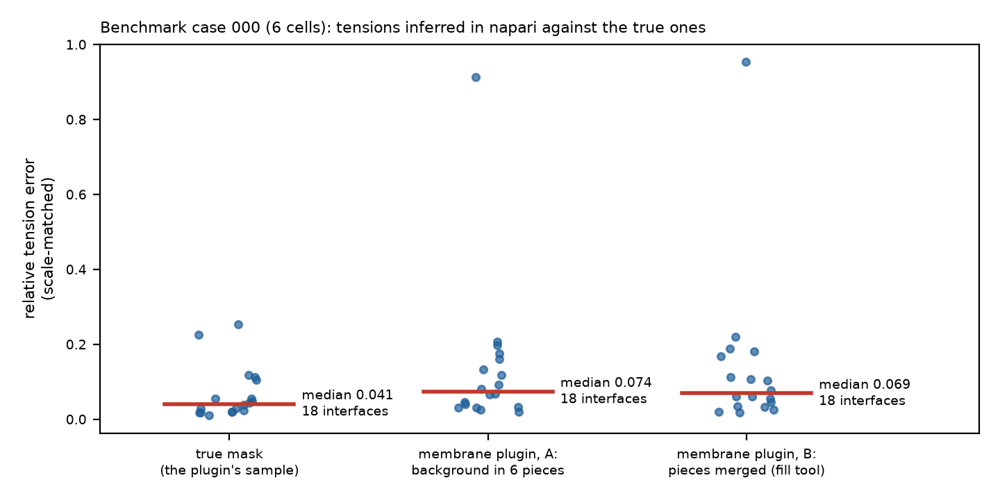

# R124 — napari-foambryo: phase B, the build (overnight, 11–12 October 2026)

**Status: built and checked; not released.** napari-foambryo 0.1.0.dev0 runs in napari 0.9.2 on this Mac:
Reconstruct, Infer (one mesh or a seed ensemble), Results, Export, a `.rec` reader and writer, and sample data,
with every number bitwise the library's and every exported file byte for byte the `foambryo` command's. The
choices made without anyone to ask are in `phase_b_decision_log.md` (22 entries).

*Figure 1. Benchmark case 000 (6 cells, 18 interfaces): tensions inferred in napari against the true ones, after
matching the scale. From the true mask (the plugin's sample data), median relative error 0.041; from a membrane
segmentation plugin's labels on the case's synthetic microscopy stack, 0.074 as the plugin leaves them (the
background in six pieces, five of which become cut cells) and 0.069 once those pieces are merged into the
background. One interface (0–1, the lowest true tension) carries most of the difference (`MEASURED`).*

## What was built

| repository | branch | commits | what |
|---|---|---|---|
| foambryo | `feature/public-helpers-for-front-ends` (on `feature/the-foambryo-command` 669a976) | ac8cd0c, 6daeebe, ce2125a, c274e54 | the command's helpers made public (decisions Q1, Q7, Q10, and the mask report); the command calls them |
| napari-foambryo | `feature/first-version` (on `main` a90721f) | adcb9f4 … 7613194 (10 commits) | the plugin, its tests, README, examples, the specification |
| napari-foambryo | `research/R124-napari-foambryo-plugin` | 7ba4a41 (specification version 1), e9f8183, cfded9a, 75501a8, and this record | the specification, the decision log, the scripts, results, figures, screenshots |

delaunay-watershed-3d is unchanged (used at `master` 68eccf4).

## Checks

| check | result |
|---|---|
| foambryo suite, command branch 669a976 (baseline) | 927 passed, 1 skipped |
| foambryo suite, helpers tip c274e54 | 951 passed, 1 skipped (the 24 new tests; the same skip) |
| the command's tests on the first three helper commits | unchanged and passing; the fourth commit changes one assertion (the mask report line of `foambryo mesh`) |
| ruff, foambryo | 23 findings at 669a976, the same 23 at the helpers tip |
| ty, foambryo (dw3d's `ty`, foambryo's venv) | 189 diagnostics at 669a976, 179 at the tip; the only new lines are three moved verbatim from `cli.py` to `results.py` |
| napari-foambryo suite (tiers T1–T3, headless, Qt offscreen) | 87 passed, 0 skipped (at 7613194) |
| ruff, napari-foambryo | all checks passed; formatted |
| gates G1–G11 | all passing (`docs/SPECIFICATION.md` § 8; table below) |
| tier T4 (napari's `make_napari_viewer`, OpenGL) | not run as a test: no OpenGL in Qt's offscreen platform here. Replaced by real-window runs (below) |
| real-window runs (napari 0.9.2, this Mac's display) | the launcher on case 000; the segmentation-plugin check (variants A and B); both examples; the cropped foam and the 90-cell tissue (see below) |
| scanners (R091) | napari-foambryo: named parties only in `README.md` (the fixed credits paragraph and the citation's authors, the intended hits); the forbidden group empty; 28 commits, all Hervé's; secrets: 0 hits in 75 blobs. foambryo's four new commits: no hit (two `@pytest` decorators matched the e-mail pattern) |
| root check | OK at the start, after each milestone, at the end |

| gate | what | test |
|---|---|---|
| G1–G3 | the mesh from the child process, and every tension and pressure method, bitwise the library's (cubic, anisotropic, cropped); refusals with the command's status | `test_numbers_are_the_librarys.py` |
| G4 | a seed ensemble from the child process bitwise the library's, 1 and 2 workers | `test_runner_cancel_and_ensembles.py` |
| G5 | the in-memory and `.rec` routes bitwise equal on case 000 cut by the image box | same |
| G6 | Export byte for byte `foambryo mesh` / `foambryo infer` / `foambryo infer-over-seeds`; the run record's schema-1 keys and values | `test_export_is_the_command.py`, `test_runner_cancel_and_ensembles.py` |
| G7, G8 | the layers' colours are foambryo's colour functions; every display copy maps back exactly; the frames | `test_display_copies_and_colours.py` |
| G9 | the estimate reproduces its anchors within its band; the memory guard's three levels; *run anyway* | `test_masks_spacing_and_estimate.py`, `test_widgets_walk_through.py` |
| G10 | every widget default is the library's | `test_widgets_walk_through.py` |
| G11 | another plugin's output (uint16, sparse labels, background 1, no scale, a leading axis, dask) bitwise the library's on the clean mask, through the widgets | `test_from_another_plugins_segmentation.py` |
| Cancel | stops a slow child and the process it started, within seconds | `test_runner_cancel_and_ensembles.py` |

## The manual checks (`MEASURED`, real napari window)

* **Case 000 through the launcher** (`scratch/napari-foambryo/try_napari_foambryo.zsh --smoke-test`):
  1 712 points, 3 571 triangles, 6 cells in 10.8 s (most of it the child process's start), peak 0.76 GiB; inference
  0.3 s; median relative tension error 0.041; Export wrote the five files. Screenshots 01–06.
* **From a segmentation plugin** (napari-segment-blobs-and-things-with-membranes 0.3.12, BSD-3-Clause;
  `scripts/manual_check_from_a_membrane_segmentation_plugin.py`, `results/…on_case_000.json`): the plugin's
  labels have no voxel size and the background is label 1 in six pieces; the mask report said "11 cells; 5 touch
  the image box" before Run. Variant A (as left): 11 cells, 5 of them fake cut cells, 3 595 points, peak 7.7 GiB;
  18 of 18 true interfaces found, median error 0.074, plus 23 interfaces with the fake cells. Variant B (pieces
  merged): 6 cells, 1 710 points, peak 1.4 GiB, median error 0.069. Screenshots 07–09.
* **The cropped foam and a 90-cell simulated tissue at real cell size** (`results/smoke_runs_on_a_cropped_foam_
  and_a_90_cell_tissue.json`, screenshots 10–11; under the heavy-run lock, held 40 s at 01:46 once R132 released it):
  the cropped foam, 8 cut cells, their 8 pressures `nan`; the 90-cell tissue (342 × 351 × 350 voxels), 11 203
  points, 25 433 triangles, 91 cells in 21.7 s, peak 4.15 GiB, against an estimate of 24 s (15–38) and 5 GiB (3–7);
  449 interfaces, median relative tension error 0.138 against the true tensions restricted to the reference
  mesh's interfaces (the library's single-seed figure at real cell size is 0.152, CHANGELOG).

## Findings

1. **A real window finds what headless tests do not.** napari hands each plugin widget its own viewer proxy (the
   widgets' shared session must be keyed by the viewer behind it); in 3-D the labels' voxels hide the mesh; the
   spawn-based runner hangs when Python reads its script from standard input. All fixed; the first is now tested.
2. **Another plugin's background is not one label.** The membrane plugin splits it into six pieces; five become
   fake cut cells with 23 fake interfaces and five times the reconstruction memory. The mask report shows it
   before Run ("5 touch the image box"); merging the pieces with napari's fill tool removes it. The README says so.
3. **One interface carries the segmentation's cost** (`MEASURED` on one case): 0–1, the lowest true tension
   (0.363), reads 0.455 from the true mask and about 0.70 from either segmentation; the other 17 move little.
   Why (`INFERRED`, `TO VERIFY`): the watershed's outer boundary of cell 1 sits away from the true surface.
4. The plugin adds the child process's start (about 5–8 s) to every reconstruction; on case 000 the estimate
   (3 s) is below the measured 10.8 s. Negligible for the large tissues the estimate is for (`INFERRED`).

## What remains `TO VERIFY`

* Tier T4 on a machine with OpenGL in continuous integration (Linux, Xvfb), and the napari floor (decision Q9:
  0.9 is the only version tested).
* The pickled size of a 1 866-cell reconstruction through the child process, and whether sending the mask by
  pickling matters at that size (decision Q6); no 1 866-cell run was made tonight (the heavy-run lock was R132's).
* The napari hub's current metadata conventions; the project URLs (the repositories do not exist yet).
* Finding 3's cause.
* Python 3.11 and 3.13 (only 3.12 was run).
